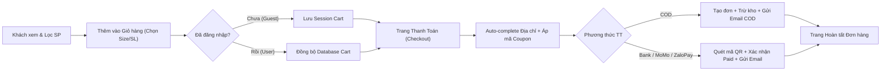
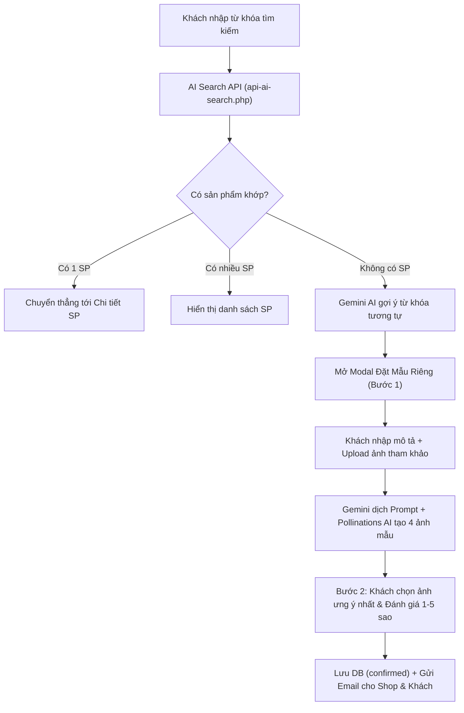

# 🧸 Teddy Bear Paradise — E-Commerce & AI-Powered Custom Plush Toy Platform

> **Đồ án cá nhân** — Hệ thống thương mại điện tử chuyên kinh doanh gấu bông trực tuyến tích hợp Trí tuệ nhân tạo (**Google Gemini AI**, **Pollinations AI**), gợi ý địa chỉ thông minh (**Goong Maps API**) và thanh toán QR tự động.

---

## 📌 1. Tổng quan dự án (Project Overview)

**Teddy Bear Paradise** là nền tảng thương mại điện tử Full-stack được xây dựng nhằm giải quyết trọn vẹn bài toán mua sắm gấu bông trực tuyến: từ tìm kiếm sản phẩm bằng ngôn ngữ tự nhiên, tư vấn tự động 24/7, cá nhân hóa mẫu gấu bông theo yêu cầu riêng bằng AI, đến thanh toán tự động qua mã QR và quản trị vận hành toàn diện.

### ✨ Điểm nổi bật (Key Highlights cho CV / Portfolio)
- 🤖 **Trợ lý ảo Teddy AI (RAG-lite Chatbot):** Kết nối trực tiếp cơ sở dữ liệu sản phẩm và mã khuyến mãi theo thời gian thực với **Google Gemini 1.5 Flash**, kết hợp cơ chế **Intelligent Fallback Engine** đảm bảo phản hồi 100% ngay cả khi ngoại tuyến.
- 🎨 **Đặt mẫu gấu bông riêng bằng AI (2-Step Custom Order Workflow):** Khi khách hàng tìm kiếm sản phẩm chưa có trong shop, hệ thống tự động gợi ý từ khóa bằng AI hoặc cho phép mô tả mẫu riêng $\rightarrow$ dịch và tối ưu prompt qua Gemini $\rightarrow$ sinh 4 mẫu ảnh gấu bông 3D bằng **Pollinations AI (Flux model)** để khách chọn, chấm sao và gửi thông báo email cho chủ shop.
- 📍 **Tự động hoàn thiện & chuẩn hóa địa chỉ (Smart Address Autocomplete):** Tích hợp **Goong Maps Geocoding API** kết hợp **Gemini AI** để gợi ý và chuẩn hóa địa chỉ giao hàng (Tỉnh/Thành, Quận/Huyện, Phường/Xã).
- 💳 **Thanh toán đa phương thức & Giả lập quét QR tự động:** Hỗ trợ COD, Chuyển khoản ngân hàng, Ví MoMo, ZaloPay kèm đếm ngược xác nhận giao dịch và gửi Email HTML tự động theo từng hình thức thanh toán.
- 🛡️ **Kiến trúc bảo mật & Tối ưu:** Sử dụng MySQLi Prepared Statements chống SQL Injection, mã hóa mật khẩu `bcrypt` (`password_hash`), quản lý Transaction (`BEGIN` / `COMMIT` / `ROLLBACK`) đảm bảo toàn vẹn tồn kho khi đặt/hủy đơn.

---

## 🛠️ 2. Công nghệ sử dụng (Tech Stack)

| Phân tầng | Công nghệ / Thư viện |
| :--- | :--- |
| **Backend** | PHP 8.x (OOP Database Wrapper, Session & Cookie Auth, REST-style JSON APIs) |
| **Database** | MySQL / MariaDB (`utf8mb4`, 12 bảng quan hệ, Transactions) |
| **Frontend** | HTML5, CSS3 (Custom Cute Theme), JavaScript (ES6+ Fetch API), Bootstrap 5.3, jQuery |
| **AI & Tích hợp bên thứ 3** | • **Google Gemini 1.5 Flash API** (Chatbot tư vấn, AI Search, Tối ưu Prompt, Chuẩn hóa địa chỉ)<br>• **Pollinations AI** (Sinh ảnh mẫu gấu bông theo mô tả khách hàng)<br>• **Goong Maps API** (Gợi ý địa chỉ giao hàng kèm tọa độ)<br>• **SMTP / HTML Email** (Thông báo đơn hàng COD, Paid, Custom Order) |
| **Môi trường chạy** | Apache (XAMPP / Laragon / LAMP) |

---

## 🔄 3. Quy trình nghiệp vụ chi tiết (System Workflows)

### 3.1. Quy trình Mua hàng & Thanh toán (Shopping & Checkout Flow)

1. **Giỏ hàng thông minh (`cart/`):**
   - Khách vãng lai lưu giỏ hàng trên `$_SESSION['cart']` (hỗ trợ phân biệt theo `product_id|size`).
   - Ngay khi khách đăng nhập (`auth/login.php`), hàm `mergeSessionCartToDatabase()` tự động gộp giỏ hàng từ Session vào bảng `cart` trong MySQL mà không làm mất sản phẩm đã chọn.
2. **Kiểm tra & Áp dụng mã giảm giá (`cart/apply-coupon.php`):**
   - Kiểm tra hiệu lực mã giảm giá (ngày bắt đầu/kết thúc, số lượt sử dụng tối đa `usage_limit`, giá trị đơn tối thiểu `minimum_amount`).
   - Hỗ trợ giảm theo phần trăm (`percentage`) hoặc số tiền cố định (`fixed`).
3. **Đặt hàng an toàn với Database Transaction (`cart/checkout.php`):**
   - Khởi tạo Transaction $\rightarrow$ Tạo mã đơn duy nhất (`TB + YYYYMMDD + 4 số`) $\rightarrow$ Kiểm tra tồn kho thực tế của từng mặt hàng $\rightarrow$ Lưu `orders` & `order_items` $\rightarrow$ Trừ `stock_quantity` trong bảng `products` và tăng `usage_count` của `coupons` $\rightarrow$ `COMMIT` và làm trống giỏ hàng.

---

### 3.2. Quy trình Tìm kiếm AI & Đặt hàng theo mẫu riêng (AI Search & Custom Order Flow)

1. **Bước 1 — Gửi yêu cầu (`pages/api-custom-order.php`):**
   - Nhận thông tin khách hàng, từ khóa, mô tả chi tiết và ảnh tham khảo (nếu có).
   - Lưu bản ghi vào bảng `custom_orders` với trạng thái `waiting_images`.
   - Gọi Gemini AI chuyển đổi mô tả tiếng Việt sang câu lệnh tiếng Anh chuyên sâu và sinh 4 biến thể ảnh gấu bông (Classic, Cute Chibi, Luxury, Cozy).
2. **Bước 2 — Chọn mẫu & Đánh giá (`pages/api-confirm-custom-order.php`):**
   - Khách hàng chọn mẫu ảnh AI ưng ý nhất và đánh giá mức độ hài lòng (1–5 sao).
   - Hệ thống cập nhật `selected_image_url`, `rating`, chuyển trạng thái sang `confirmed`, đồng thời gửi email kèm hình ảnh cho chủ shop và khách hàng.

---

### 3.3. Quy trình Quản trị viên (Admin Management Flow)
- **Dashboard (`admin/dashboard.php`):** Thống kê theo thời gian thực tổng sản phẩm, tổng đơn hàng, đơn chờ xử lý, đơn trong ngày, doanh thu đã thanh toán và số mã giảm giá đang hoạt động.
- **Quản lý Sản phẩm (`admin/manage-products.php`, `add-product.php`, `edit-product.php`):** Thêm/sửa/xóa sản phẩm, tự động tạo đường dẫn thân thiện (`slug`) từ tiếng Việt có dấu, tải ảnh đại diện, cấu hình SEO (`meta_title`, `meta_description`) và gắn nhãn `SALE` / `LIMITED`.
- **Quản lý Đơn hàng (`admin/manage-orders.php`):** Lọc đơn theo mã, tên khách, trạng thái, ngày đặt. Chuyển đổi trạng thái theo đúng vòng đời: `Chờ xử lý (pending)` $\rightarrow$ `Đã xác nhận (confirmed)` $\rightarrow$ `Đang xử lý (processing)` $\rightarrow$ `Đang giao (shipping)` $\rightarrow$ `Đã giao (delivered)` (tự động cập nhật `payment_status = 'paid'`).
- **Quản lý Đơn đặt mẫu riêng (`admin/manage-custom-orders.php`):** Xem chi tiết mô tả, ảnh khách tải lên, ảnh AI khách đã chọn, số sao đánh giá và phản hồi trực tiếp cho khách.

---

## 🗄️ 4. Cấu trúc Cơ sở dữ liệu (Database Schema)

Cơ sở dữ liệu `teddy_bear_shop` gồm **12 bảng** được chuẩn hóa:
1. `users`: Thông tin khách hàng (`id`, `username`, `email`, `password`, `full_name`, `phone`, `address`, `gender`, `birthday`, `avatar`, `status`).
2. `admins`: Tài khoản quản trị viên (`id`, `username`, `email`, `password`, `full_name`, `role`, `status`).
3. `categories`: Danh mục gấu bông (`id`, `name`, `slug`, `description`, `image`, `status`).
4. `products`: Sản phẩm (`id`, `name`, `slug`, `description`, `short_description`, `price`, `sale_price`, `stock_quantity`, `category_id`, `main_image`, `gallery`, `size`, `color`, `material`, `weight`, `is_featured`, `is_limited`, `views`, `rating`, `review_count`, `status`).
5. `cart`: Giỏ hàng lưu DB cho thành viên (`id`, `user_id`, `product_id`, `quantity`, `size`).
6. `orders`: Đơn hàng (`id`, `order_number`, `user_id`, `customer_name`, `customer_email`, `customer_phone`, `shipping_address`, `subtotal`, `shipping_fee`, `total_amount`, `payment_method`, `payment_status`, `order_status`, `notes`).
7. `order_items`: Chi tiết từng sản phẩm trong đơn (`id`, `order_id`, `product_id`, `product_name`, `product_image`, `quantity`, `price`, `total`).
8. `coupons`: Mã khuyến mãi (`id`, `code`, `name`, `type`, `value`, `minimum_amount`, `usage_limit`, `usage_count`, `start_date`, `end_date`, `status`).
9. `reviews`: Đánh giá sản phẩm (`id`, `product_id`, `user_id`, `customer_name`, `rating`, `comment`, `status`).
10. `custom_orders`: Yêu cầu đặt mẫu gấu bông riêng (`id`, `customer_name`, `customer_email`, `customer_phone`, `search_keyword`, `description`, `image_url`, `selected_image_url`, `rating`, `status`, `shop_message`, `ip_address`).
11. `contact_messages`: Tin nhắn liên hệ từ khách hàng (`id`, `name`, `email`, `phone`, `subject`, `message`, `status`).
12. `settings`: Cấu hình hệ thống động (`id`, `setting_key`, `setting_value`, `description`).

---

## 📂 5. Cấu trúc thư mục dự án (Directory Structure)

```text
teddy_bear_shop/
├── admin/                  # Phân hệ Quản trị viên (Dashboard, CRUD Sản phẩm, Đơn hàng, Coupon, Custom Orders)
│   └── partials/           # Sidebar menu, header, footer của Admin
├── auth/                   # Xác thực người dùng (Đăng nhập, Đăng ký, Đăng xuất, Remember Me)
├── cart/                   # Giỏ hàng, Áp dụng mã giảm giá, Thanh toán (Checkout), Giả lập QR Payment
├── config/                 # Cấu hình trung tâm (config.php), Class Database (MySQLi Prepared Statements)
├── css/                    # Hệ thống giao diện (style.css, cute-effects.css, auth-modern.css, admin...)
├── fonts/                  # Font chữ tiếng Việt dễ thương (UVN Van)
├── images/                 # Hình ảnh sản phẩm, danh mục, banner và ảnh khách đặt mẫu riêng
├── includes/               # Các thành phần dùng chung (header.php, footer.php, ai-chatbot.php, email_functions.php)
├── js/                     # Xử lý Frontend & AJAX (cart.js, search.js, address-autocomplete.js, product-review.js)
├── migrations/             # Script khởi tạo/nâng cấp bảng dữ liệu bổ sung
├── pages/                  # Các trang hiển thị & REST API endpoints (products, product-detail, search, api-*)
├── user/                   # Trang cá nhân khách hàng (Hồ sơ, Đổi mật khẩu, Lịch sử & Hủy đơn hàng)
├── index.php               # Trang chủ cửa hàng
└── teddy_bear_shop.sql     # File SQL đầy đủ cấu trúc 12 bảng và dữ liệu mẫu (40 sản phẩm)
```

---

## 🚀 6. Hướng dẫn cài đặt & Khởi chạy (Installation Guide)

### Bước 1: Clone dự án
```bash
git clone https://github.com/MemorisDuy/teddy_bear_shop.git
```
Đặt thư mục `teddy_bear_shop` vào `C:\xampp\htdocs\teddy_bear_shop` (hoặc cấu hình `Alias /teddy_bear_shop` trong Apache trỏ tới thư mục dự án).

### Bước 2: Khởi tạo Cơ sở dữ liệu
1. Mở **XAMPP Control Panel**, khởi động **Apache** và **MySQL**.
2. Truy cập `http://localhost/phpmyadmin`.
3. Tạo cơ sở dữ liệu mới tên **`teddy_bear_shop`** (bảng mã `utf8mb4_general_ci`).
4. Chọn tab **Import** $\rightarrow$ Chọn file `teddy_bear_shop.sql` trong thư mục gốc dự án $\rightarrow$ Nhấn **Go**.

### Bước 3: Kiểm tra cấu hình kết nối
Mở file `config/config.php` và kiểm tra thông số kết nối (mặc định chuẩn XAMPP):
```php
define('SITE_URL', 'http://localhost/teddy_bear_shop');
define('DB_HOST', 'localhost');
define('DB_NAME', 'teddy_bear_shop');
define('DB_USER', 'root');
define('DB_PASS', '');
```

### Bước 4: Truy cập hệ thống
- **Trang chủ Khách hàng:** `http://localhost/teddy_bear_shop/`
- **Trang Quản trị (Admin Panel):** `http://localhost/teddy_bear_shop/admin/`

---

## 🔐 7. Tài khoản trải nghiệm (Demo Credentials)

| Phân quyền | Tài khoản / Email | Mật khẩu | Đường dẫn đăng nhập |
| :--- | :--- | :--- | :--- |
| **Quản trị viên (Admin)** | `admin` hoặc `admin@teddyshop.com` | `admin123` | `/admin/admin-login.php` |
| **Khách hàng (User)** | `user@demo.com` *(hoặc đăng ký mới)* | `123456` | `/auth/login.php` |

---

## 👨‍💻 Tác giả (Author)
- **Thực hiện:** Nguyễn Ngọc Duy (@MemorisDuy)
- **GitHub:** [https://github.com/MemorisDuy/teddy_bear_shop](https://github.com/MemorisDuy/teddy_bear_shop)

> © 2026 Teddy Bear Paradise — Đồ án cá nhân. 🧸 All rights reserved.
